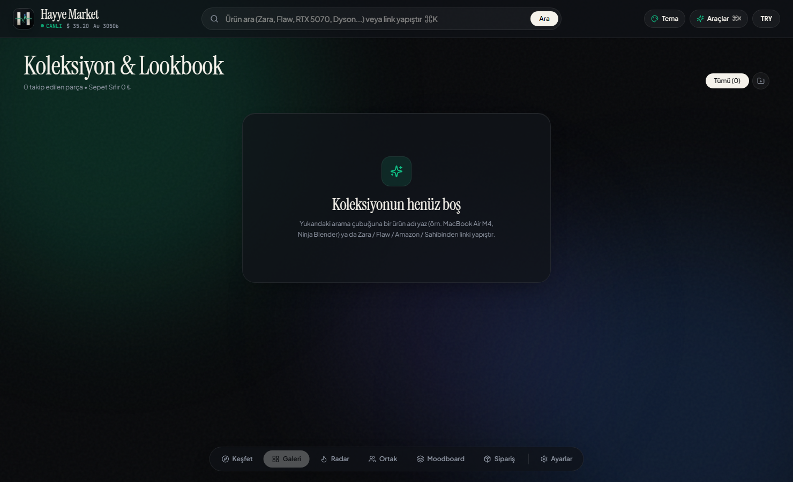
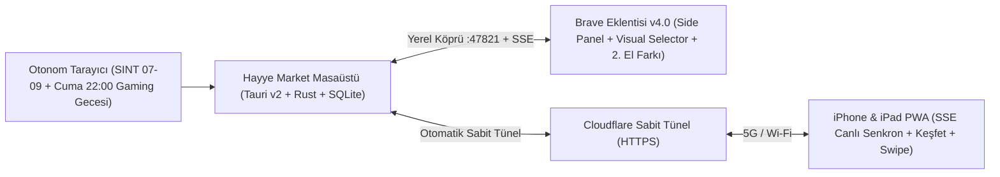

<div align="center">
  
  <h1>HAYYE MARKET</h1>
  <p><strong>Türkiye'nin Evrensel Fiyat, Stok, Moda/Kozmetik, 2. El &amp; Keşfet İstihbarat İşletim Sistemi</strong></p>
  <p>
    
    
    
    
  </p>
</div>

<br />

<div align="center">
  
  <br />
  <sub><em>Hayye Market v4.1.0 — Canlı Animated Mesh Atmosferi, Liquid Glass Yüzeyler, Yüzen Cam Dock &amp; 3D Stüdyo İkonu</em></sub>
</div>

---

## Ekosistem Mimarisi

Tek yerel çekirdek (**Rust + gömülü SQLite**), üç senkron yüzey (**Windows Masaüstü**, **65+ Mağazalı Brave Yan Panel Eklentisi**, **iPhone & iPad Safari PWA**):



---

## Öne Çıkan Yetenekler

| Modül | Ne Yapar? |
| :--- | :--- |
| **Keşfet (Discover) & Fiyat Aralıklı Arama** | 120+ canlı doğrulanmış fiyat düşüşünü tarar; **Günün En Büyük 5 Düşüşü** vitrini, **Sezon & Kampanya Takvimi** (Inditex, İncehesap Gaming Gecesi Cuma 22:00, Sephora/Gratis, Prime Day), **Anti-Çöp Susturma** ve **`Min ₺ – Max ₺` fiyat aralıklı canlı arama** (örn. *1000–1500 ₺ kulaklık*). |
| **Sahte İndirim Dedektörü & TL / USD / Gram Altın** | Fiyat geçmişini TL, canlı USD ve **Gram Altın** bazında ölçer; bindirim sonrası sahte indirimi anında yakalar. Sezon öncesi tek tık **Fiyat Dondur (Snapshot)**. |
| **5 Canlı Atmosferik Tema + Framer Motion** | `Obsidian Aurora`, `Noir Velvet`, `Atelier Ivory` (aydınlık editoryal), `Arctic Frost` (visionOS buzlu cam), `Midnight Botanical` — Masaüstü, Brave Yan Panel ve iOS PWA tek merkezden senkron. Prosedürel **WebAudio** mikro sesler, **Apple Music adaptif ürün rengi** ve **`Ctrl+K` Komut Paleti**. |
| **Moda, Inditex & Kozmetik Zekâsı** | `ikas`, `Shopify` (Sniper 1-tık sepet linki) ve `JSON-LD` ayrıştırıcı; **Beden Bazlı Stok Alarmı** (`SINT 07:00–09:00` sık tarama), **Inditex Dalga Tahmincisi**, **10 ml / 10 gr birim fiyat**, **Batch Code** ve **Parfüm Muadil (Dupe)** kartı. |
| **Yurt Dışı Yolcu Beraberi (Glocalzone & Grabr)** | Türkiye'de 30€ kargo muafiyetinin kalkmasına uygun **Kendi Seyahatin (Tax-Free -%10)** ve **Glocalzone / Grabr** (ayarlanabilir yolcu ödülü + hizmet bedeli) net kıyaslama + tek tık `Glocalzone`, `Grabr`, `Amazon.de`, `Idealo.de` araması. |
| **2. El Piyasa & Lokal Ollama Kusur Dedektörü** | Sahibinden, Dolap, Letgo, Gardrops ilanlarında %0–100 Güvenilirlik skoru, Brave'de **Yeni İlan Farkı (`✦ YENİ` / `↓ DÜŞTÜ`)** ve PC'deki lokal **Ollama** ile gizli kusur & adil pazarlık analizi. |
| **Ortak Pano, Moodboard & Gizli Hediye Kasası** | İki kişilik **Al / Bekle / Pas** oylaması (SSE ile anında senkron + iOS Swipe-to-Vote), aylık bütçe çubuğu, görsel **Moodboard**, **14 Gün İade Koruması**, **Kargo + 2 Yıl Garanti Kasası**, **Dijital Dolap (Cost-Per-Wear) & 2. Elde Sat** ve diğer profilde görünmeyen **Gizli Sürpriz Hediye** kasası. |
| **Her Zaman Üstte Mini Acrylic HUD** | Çerçevesiz, şeffaf, sürüklenebilir mini masaüstü fiyat & hızlı alım kapsülü (`Ctrl+K` ile aç/kapa). |

---

## Kurulum

### 1. Windows Masaüstü Uygulaması
[Releases](https://github.com/murasakimono/hayye-market/releases/latest) sayfasından **`Hayye Market_4.1.0_x64-setup.exe`** dosyasını indirip kur.

### 2. 65+ Mağazalı Brave / Chromium Yan Panel Eklentisi
1. `brave://extensions` (veya `chrome://extensions`) adresini aç ve **Geliştirici modu**nu etkinleştir.
2. **Paketlenmemiş öğe yükle** diyerek [`extension/`](./extension) klasörünü seç.
3. Eklenti ikonuna bastığında sağdan kalıcı **Hayye Market Yan Paneli** açılır; destek listesinde olmayan siteler için **🎯 Görsel Fiyat Seçici (Visual Selector)** kullanabilirsin.

### 3. iPhone & iPad Uygulaması (App Store Gerektirmez)
- **Ev Wi-Fi:** Uygulama → Ayarlar içindeki Ev Wi-Fi adresini (`http://<PC-IP>:47821/app`) Safari'de aç → **Paylaş → Ana Ekrana Ekle**.
- **Ev Dışı Sabit Erişim (5G):** Ayarlar'a kendi Cloudflare Worker ([`cloudflare-worker/worker.js`](./cloudflare-worker/worker.js)) veya Zero Trust Tunnel bilgini bir kez gir; uygulama açıldığında tünel otomatik bağlanır.

---

## Kaynaktan Derleme

```bash
npm install
npm run tauri build
```
